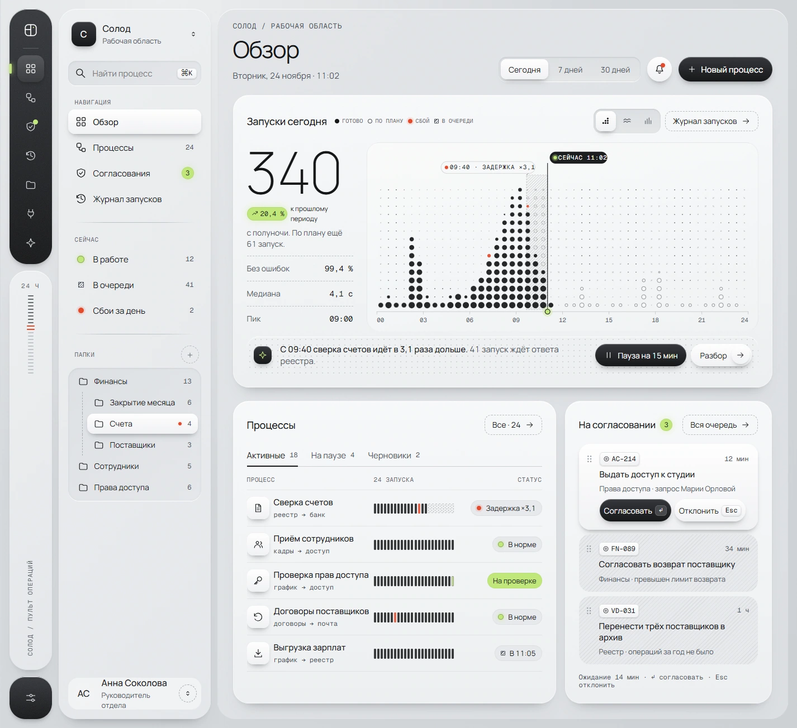
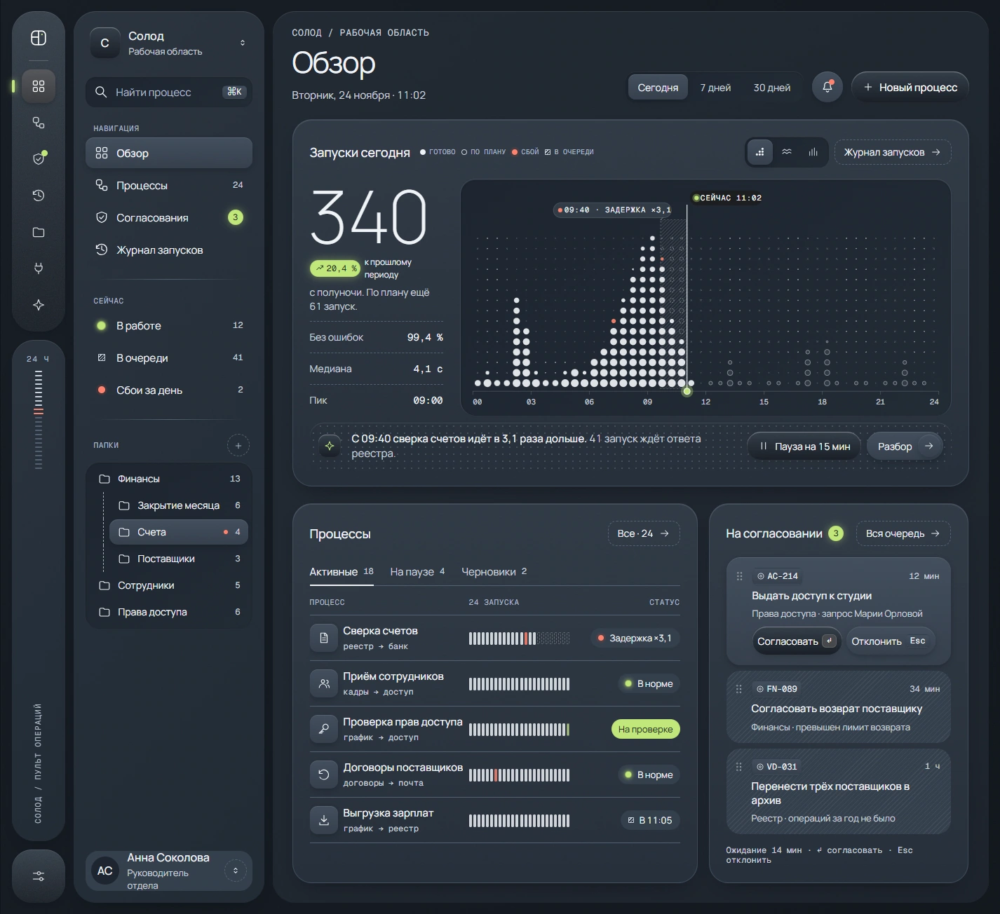
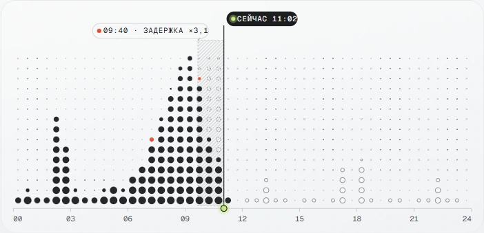
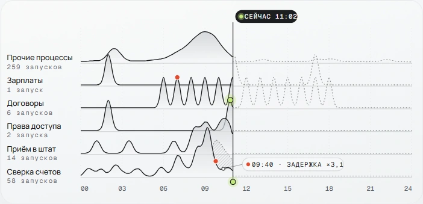
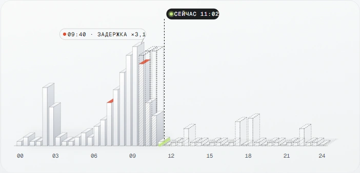
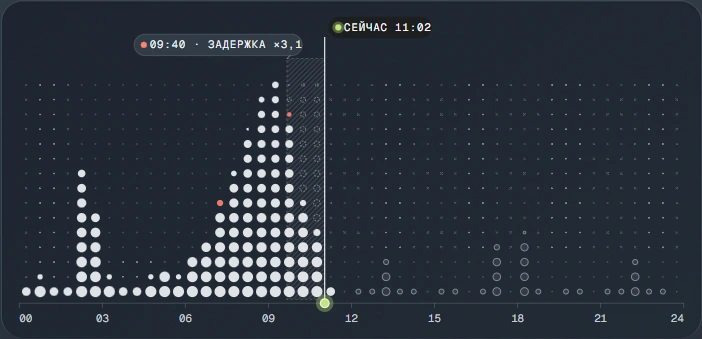
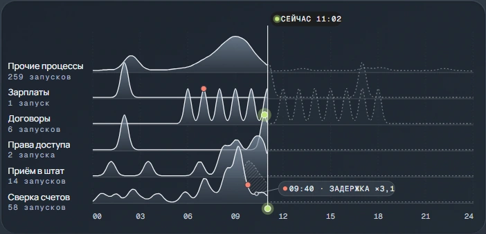
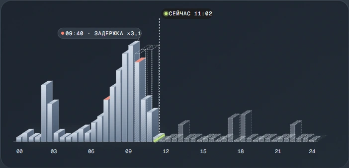
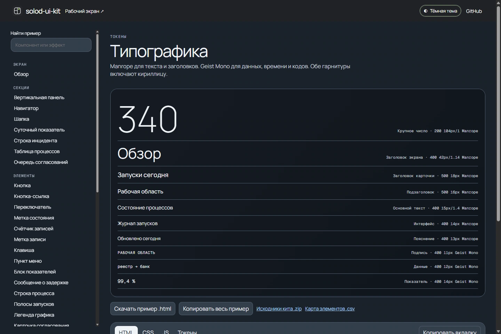
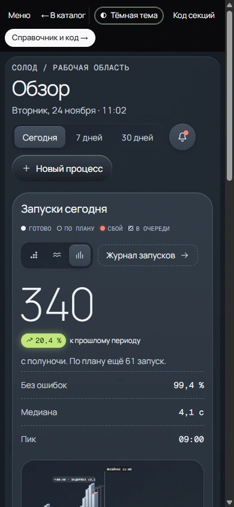

# solod-ui-kit

Русскоязычный UI-кит для панелей управления процессами. На рабочем экране можно посмотреть нагрузку за день, найти процесс, разобрать задержку и согласовать заявку. В справочнике каждый компонент открывается отдельно вместе с кодом и данными.

[Рабочий экран](https://marketing.parkskazka.ru/ops-ui-kit/) · [Справочник с 39 примерами](https://marketing.parkskazka.ru/ops-ui-kit/guide.html) · [Скачать релиз](https://github.com/rdsolod-ui/solod-ui-kit/releases/latest)

| Светлая тема | Тёмная тема |
| --- | --- |
| [](docs/screenshots/dashboard-light.webp) | [](docs/screenshots/dashboard-dark.webp) |

### Один день, три графика

Все три графика используют один суточный ряд с шагом 30 минут. Линия текущего времени отделяет фактические запуски от прогноза. Сбой отмечен цветом, очередь — штриховкой или контуром.

| Точки | Профили | Башни |
| --- | --- | --- |
|  |  |  |
|  |  |  |
| Одна колонка точек на интервал. | Отдельная кривая для каждого процесса. | Высота столбца показывает нагрузку, пунктир обозначает ожидание. |

### Компоненты и код

В библиотеке есть рабочий экран, семь секций, четырнадцать элементов, три графика, четыре примера движения, шесть материалов и четыре группы дизайн-токенов. В карточке примера можно изменить параметры, скопировать HTML, CSS или JavaScript и скачать автономный HTML. Для графиков доступны также SVG и JSON.

Скачанный пример включает выбранную тему, необходимые функции и файлы шрифтов. Его можно открыть без подключения к сети. Таблица соответствий содержит селекторы, координаты, шрифты и цвет элементов для трёх видов графика в обеих темах. [Карта элементов в CSV](element-map.csv)

### Типографика и цвет

Manrope используется для русского текста и заголовков. Моноширинный Geist Mono выравнивает время, идентификаторы и числовые значения. Обе гарнитуры поставляются локально с кириллицей и латиницей. В справочнике показаны размеры, начертания и межстрочные интервалы для каждой роли.

| Фисташка | Бирюза | Абрикос | Сирень |
| --- | --- | --- | --- |
| `#C1E879` | `#84DECF` | `#FFB684` | `#CAB9F3` |

При первом открытии тема следует настройке устройства. Ручной выбор сохраняется в браузере и действует на рабочем экране и в справочнике. Сокращённое движение учитывается и при смене настройки на открытой странице.

| Типографическая шкала в справочнике | Рабочий экран на телефоне |
| --- | --- |
| [](docs/screenshots/guide-dark.webp) | [](docs/screenshots/mobile-dark.webp) |

### Запуск

Для сборки нужны Node.js 20 или новее и Python 3.9 или новее. Сторонние npm-пакеты не требуются.

```sh
node build.mjs
python package.py
python -m http.server 8080 --directory dist
```

Откройте `http://localhost:8080/` для рабочего экрана или `http://localhost:8080/guide.html` для справочника. В релизе есть готовая статическая сборка и отдельный архив редактируемых исходников. Данные демонстрационные. Созданные процессы и решения по заявкам действуют до перезагрузки страницы.

### Устройство проекта

| Файлы | Назначение |
| --- | --- |
| `views.mjs`, `icons.mjs`, `charts.mjs` | Разметка секций, иконки и SVG-графики |
| `data.mjs`, `runtime.mjs` | Демоданные, русские подписи, действия и анимации |
| `kit.css`, `theme.css`, `theme.js` | Компоненты, кириллическая типографика и переключение темы |
| `specs.mjs`, `guide.js`, `specimen.css` | Живые примеры, варианты и экспорт |
| `index.js`, `site.css` | Оболочка предпросмотра и мобильная компоновка |
| `build.mjs`, `package.py` | Сборка, упаковка и контрольные суммы |

Композиция экрана опирается на публичный предпросмотр Mullion от Dixi. Реализация, русское демонаполнение и скриншоты в этом репозитории относятся к solod-ui-kit. [Визуальный референс](https://www.dixi.agency/kit) · [Лицензия Manrope](fonts/manrope-OFL.txt) · [Лицензия Geist Mono](fonts/geistmono-OFL.txt)
